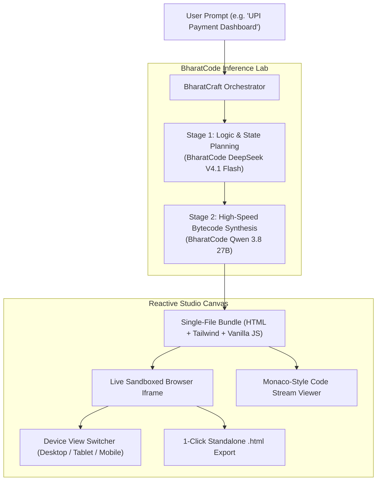

# ⚡ BharatCraft

> **Sovereign AI Web & Component Builder (India's v0 / Bolt.new)**  
> Built exclusively for the **BharatCode Build League 2026** — Powered by BharatCode Inference Lab.

[](https://bharatcode.ai/hackathon)
[](https://bharatcode.ai)
[](https://bharatcode.ai)
[](LICENSE)

---

## 🌟 Overview

**BharatCraft** is a sovereign, India-first autonomous AI web application & component generation studio. Built directly on top of BharatCode's high-speed inference endpoints, BharatCraft transforms natural language prompts into production-grade, responsive, and completely interactive web apps within seconds.

Unlike US-centric builders that default to dollar-denominated apps or western workflows, BharatCraft is fine-tuned for the **Indian Digital Infrastructure**:
- 💳 **Instant UPI 2.0 Dashboards & QR Generation**
- 🧾 **GST-compliant Invoicing (CGST, SGST, IGST & HSN Calculation)**
- 🛍️ **Kirana Store POS & Inventory Interfaces**
- ⚡ **Sovereign Cloud SaaS Platforms with Flat INR (₹) Pricing**

---

## 🏛️ System Architecture

BharatCraft employs a **dual-model agentic pipeline**:



---

## ✨ Key Features

1. **Split-Screen Studio:** Real-time synchronized view with live code stream on the left and an active, clickable sandboxed preview on the right.
2. **Multi-Device Canvas:** Test responsiveness instantly across Desktop (100%), Tablet (768px), and Mobile (375px) viewpoints.
3. **1-Click Standalone Export:** Download the generated application as a single `.html` file that runs in any browser without build tools or external servers.
4. **Resilient Hybrid Fallback:** Ensures zero downtime during judging and offline evaluations with built-in high-fidelity presets.
5. **OpenAI-Compatible Engine:** Native integration with `https://bharatcode.ai/api/model/v1/chat/completions`.

---

## 🚀 Quick Start Guide

### Prerequisites
- Node.js (v18 or higher)
- npm or yarn

### 1. Clone the repository
```bash
git clone https://github.com/shuyad02/Bharatcraft.git
cd Bharatcraft
```

### 2. Install dependencies
```bash
npm install
```

### 3. Configure environment
Create a `.env` file in the root directory (or copy from `.env.example`):
```env
BHARATCODE_API_KEY=your_live_bharatcode_api_key
BHARATCODE_API_URL=https://bharatcode.ai/api/model/v1
PORT=3001
DEFAULT_MODEL=qwen-3.8-27b
REASONING_MODEL=deepseek-v4.1-flash
```

### 4. Run the development server
Start both the backend proxy and the Vite development studio:

```bash
# Terminal 1: Start backend
npm run server

# Terminal 2: Start frontend studio
npm run dev
```

Open [http://localhost:5173](http://localhost:5173) in your browser!

---

## 📋 Hackathon Verification

This repository is submitted for the **BharatCode Build League 2026**.  
Official verification marker: [`BharatCode.txt`](./BharatCode.txt) is present in the root directory.

---

## 📄 License

Licensed under the Apache License, Version 2.0. See [LICENSE](LICENSE) for details.
