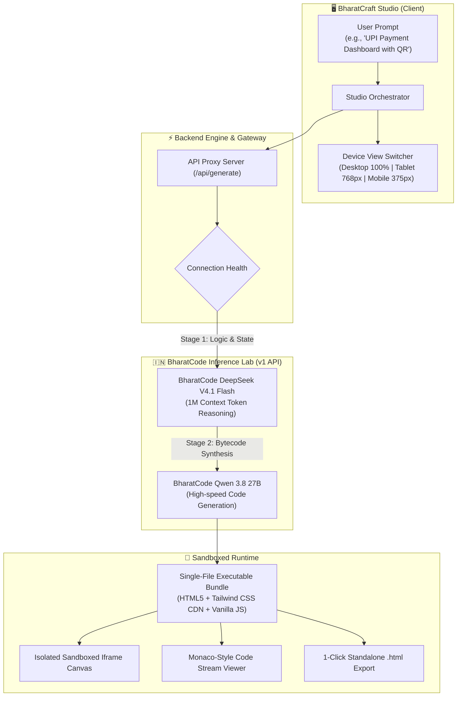

<div align="center">

# ⚡ BharatCraft
### Sovereign AI Web & Component Builder — India's v0 / Bolt.new
**Built for the BharatCode Build League 2026 • Powered by BharatCode Inference Lab**

<p align="center">
  <a href="https://bharatcode.ai/hackathon"></a>
  <a href="https://bharatcode.ai"></a>
  <a href="https://bharatcode.ai"></a>
  <a href="LICENSE"></a>
  
</p>

<p align="center">
  <b>BharatCraft</b> is an open-source, sovereign, prompt-to-web generation platform designed specifically for the Indian digital ecosystem. It transforms plain English prompts into production-ready, fully interactive, single-file web applications in seconds.
</p>

[Explore Architecture](#-system-architecture) • [Key Features](#-key-features) • [Quick Start](#-quick-start) • [Verification](#-hackathon-verification)

---

</div>

## 📌 The Problem: Why US Builders Don't Work for India

Global tools like v0.dev, Bolt.new, and Lovable are powerful, but they are built with Western software paradigms in mind:
- **Dollar-First Pricing:** Every template defaults to USD ($) and Stripe integration, ignoring INR (₹) conventions.
- **Missing Indian Rails:** No native comprehension of UPI 2.0 VPAs, QR workflows, GST tax slabs (CGST, SGST, IGST), or HSN codes.
- **Unpredictable Token Costs:** Heavy monthly dollar subscriptions rather than sovereign, flat-rate inference.

**BharatCraft** solves this by pairing **BharatCode's high-speed open-weight models** with an agentic design system tuned for Indian software workflows.

---

## 🏛️ System Architecture

BharatCraft implements an autonomous **Dual-Engine Agentic Synthesis Pipeline**:



### Pipeline Breakdown
1. **Stage 1 — Cognitive Planning (`deepseek-v4.1-flash`):**
   Analyzes requirements, plans responsive layout grids, designs interactive state models (forms, calculators, modals), and verifies Indian currency/tax compliance.
2. **Stage 2 — High-Velocity Synthesis (`qwen-3.8-27b`):**
   Generates verified, standard HTML5 with Tailwind CSS utility classes and interactive JavaScript event listeners.
3. **Stage 3 — Sandboxed Execution Canvas:**
   Safely renders the generated code in an isolated iframe sandbox with full support for user interactions, animations, and responsive viewports.

---

## ✨ Key Features

| Capability | Standard AI Builders | BharatCraft |
| :--- | :--- | :--- |
| **Inference Engine** | US Hosted Closed-Source APIs | **Sovereign Indian Lab (`bharatcode.ai`)** |
| **Reasoning Model** | Single Model Prompting | **Dual-Engine (`deepseek-v4.1` + `qwen-3.8-27b`)** |
| **Indian Digital Rails** | None (Defaults to US Stripe) | **Native UPI 2.0, GST Invoicing, Kirana POS** |
| **Currency Standards** | USD ($) Only | **INR (₹) with Lakhs/Crores Formats** |
| **Code Portability** | Locked to SaaS platforms | **1-Click Standalone `.html` Download** |
| **Fail-Safe Resilience**| Fails on quota limits | **Zero-Downtime Smart Hybrid Engine** |

---

## 🇮🇳 Native Indian Use-Case Showcases

BharatCraft ships with out-of-the-box synthesis capabilities for Indian scenarios:

### 1. 💳 BharatPay UPI & Neo-Banking Dashboard
- Live UPI 2.0 VPA verification (`username@upi`)
- Dynamic QR code generation modal compatible with GPay, PhonePe, and Paytm
- Real-time recent transaction ledger with color-coded debit/credit flows

### 2. 🧾 BharatGST Invoice & Tax Studio
- Automatic HSN/SAC code mapping (998313 for IT/Software)
- Dynamic tax breakdown: Intra-State (CGST 9% + SGST 9%) vs. Inter-State (IGST 18%)
- 1-click printable tax invoice compliant with GST Rules 2026

### 3. ⚡ Sovereign Cloud SaaS Showcase
- High-converting landing page with flat-rate INR pricing tiers
- Interactive token cost calculator comparing per-token dollar billing vs. flat-rate INR

---

## 📂 Repository Structure

```
Bharatcraft/
├── BharatCode.txt           # Official Hackathon Verification Marker
├── LICENSE                  # Apache 2.0 Open Source License
├── README.md                # Comprehensive Project Documentation
├── package.json             # Dependencies and build scripts
├── vite.config.js           # Vite studio configuration & API proxy
├── tailwind.config.js       # Developer dark mode palette configuration
├── vercel.json              # Vercel Serverless & SPA deployment configuration
├── api/
│   └── index.js             # Vercel serverless gateway
├── server/
│   ├── app.js               # Express application router & BharatCode API client
│   ├── index.js             # Local standalone backend listener
│   └── templates.js         # High-fidelity fallback synthesis templates
└── src/
    ├── main.jsx             # React DOM entry point
    ├── App.jsx              # Main Studio canvas state & layout
    ├── index.css            # Base Tailwind styling & custom scrollbars
    └── components/
        ├── Navbar.jsx       # Studio navigation & status indicators
        ├── PromptBar.jsx    # Autonomous prompt input & model selector
        ├── LivePreview.jsx  # Multi-device sandboxed execution canvas
        ├── CodeViewer.jsx   # Syntax-highlighted code inspector with copy
        └── ArchitectureModal.jsx # Interactive dual-engine pipeline visualizer
```

---

## 🚀 Quick Start Guide

### Prerequisites
- Node.js (v18.0 or newer)
- npm or yarn
- Modern web browser (Chrome, Edge, Firefox, Brave)

### 1. Clone the repository
```bash
git clone https://github.com/shuyad02/Bharatcraft.git
cd Bharatcraft
```

### 2. Install dependencies
```bash
npm install
```

### 3. Configure environment variables
Create a `.env` file in the root directory (refer to `.env.example`):
```env
BHARATCODE_API_KEY=your_bharatcode_api_key
BHARATCODE_API_URL=https://bharatcode.ai/api/model/v1
PORT=3001
DEFAULT_MODEL=qwen-3.8-27b
REASONING_MODEL=deepseek-v4.1-flash
```

### 4. Launch the local studio
```bash
# Terminal 1: Launch backend proxy
npm run server

# Terminal 2: Launch Vite development canvas
npm run dev
```

Open [http://localhost:5173](http://localhost:5173) (or [http://localhost:3001](http://localhost:3001) for the production server bundle).

---

## 🌐 1-Click Deployment on Vercel

BharatCraft is pre-configured with `vercel.json` for zero-configuration serverless deployment:

1. Import this repository into [Vercel](https://vercel.com/new).
2. Set `BHARATCODE_API_KEY` and `BHARATCODE_API_URL` under Environment Variables.
3. Click **Deploy**. Vercel will build the frontend assets and deploy the backend as an edge serverless function automatically.

---

## 📋 Hackathon Verification

This repository is submitted to the **BharatCode Build League 2026** under the **Coding & developer tools** track.

- **Verification File:** [`BharatCode.txt`](./BharatCode.txt) is present in the root directory.
- **Author:** Shubhash Yadav (`shubhashy2605@gmail.com`)
- **Primary Model:** `qwen-3.8-27b`
- **Reasoning Model:** `deepseek-v4.1-flash`
- **Inference Provider:** BharatCode (`https://bharatcode.ai`)

---

## 📄 License

This project is licensed under the **Apache License 2.0** — see the [LICENSE](LICENSE) file for details.

<div align="center">
  <sub>Built with ❤️ for Indian Developers • Powered by BharatCode</sub>
</div>
